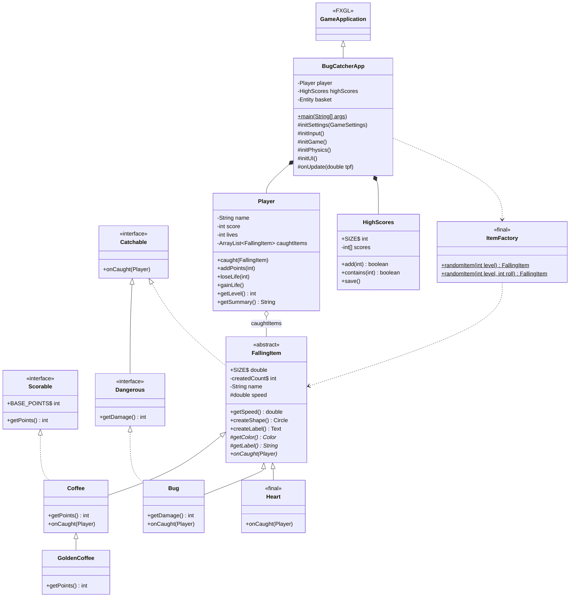

# Bug Catcher

A small arcade game made with Java and [FXGL](https://github.com/AlmasB/FXGL).
Move the basket left and right at the bottom of the screen and catch what falls:

| Item | Looks like | When caught |
|---|---|---|
| Coffee | brown `+10` | +10 points |
| Golden Coffee | gold `+50` | +50 points (rare, falls faster) |
| Bug | red `BUG` | −1 life |
| Heart | pink `1UP` | +1 life (very rare, max 5) |

You start with 3 lives. Every 100 points the level goes up and everything falls faster.
When you run out of lives, the game shows your score and the top 5 (saved in `highscores.txt`) and starts again.

**Controls:** ← / → or A / D.

## How to run

You need JDK 21 or newer. Maven comes with the project (`mvnw`).

```sh
./mvnw javafx:run                 # play
./mvnw javafx:run -Dplayer=Ana    # play with your name (command-line argument)
./mvnw test                       # run the unit tests
```

On Windows use `mvnw.cmd` instead of `./mvnw`.

## How the code is organized

```
src/main/java/bugcatcher/
├── BugCatcherApp.java      the FXGL game: window, keys, spawning, collisions, HUD
├── EntityType.java         BASKET / ITEM, used by FXGL collisions
├── items/                  everything that falls
│   ├── Catchable.java      interface: onCaught(Player)
│   ├── Scorable.java       interface: getPoints() + BASE_POINTS constant
│   ├── Dangerous.java      interface that extends Catchable: getDamage()
│   ├── FallingItem.java    abstract base class
│   ├── Coffee.java
│   ├── GoldenCoffee.java   extends Coffee
│   ├── Bug.java
│   ├── Heart.java          final class
│   └── ItemFactory.java    static methods that create random items
└── player/
    ├── Player.java         name, score, lives, caught items
    └── HighScores.java     top 5 in an int[], saved to a file
```

The game rules live in plain Java classes (`items` and `player`).
`BugCatcherApp` is the only class that talks to FXGL: it draws things, reads the keyboard and
calls `player.caught(item)` when the basket touches an item.

## Class diagram (UML)



## Where each OOP concept appears

| Concept | Where |
|---|---|
| Classes, objects, `new`, instance variables | `Player`, `HighScores`, every item; `new Player(playerName)` in `BugCatcherApp.initGame` |
| Encapsulation, getters/setters, `private` | `Player`: all fields private; `setLives` validates the value |
| `public` / `protected` / `private` | `FallingItem.speed` is `protected`; `Coffee(String, double)` is a `protected` constructor for subclasses |
| Constructor overloading, `this()`, default constructor | `Player()` → `Player(name)` → `Player(name, lives)`; `Coffee(speed)` → `this("Coffee", speed)` |
| `this` reference | `Player.setLives`: `this.lives = lives` |
| Method overloading | `ItemFactory.randomItem(level)` and `randomItem(level, roll)` |
| `static` variables and methods | `FallingItem.createdCount` / `getCreatedCount()`; `ItemFactory` methods; `main` |
| Constants (`final`) | `Player.MAX_LIVES`, `HighScores.SIZE`, `BugCatcherApp.WIDTH` |
| `Math` class | `Math.random()`, `Math.max`, `Math.min` |
| Casting and argument promotion | `(int) (Math.random() * 100)`; `(level - 1) * SPEED_PER_LEVEL` (int promoted to double) |
| Integer division | `Player.getLevel()`: `1 + score / 100` |
| Ternary operator | `BugCatcherApp.endGame`: `newRecord ? "NEW RECORD!" : "GAME OVER"` |
| Command-line arguments | `BugCatcherApp.main(String[] args)`: optional player name |
| Packages, `import` | `bugcatcher`, `bugcatcher.items`, `bugcatcher.player`; Java API (`java.nio.file`, `java.util`) |
| Arrays, `length`, array references | `HighScores.scores` (`int[]`); `getScores()` returns a copy so callers can't change ours |
| `Arrays.sort / fill / copyOf / binarySearch`, `System.arraycopy` | `HighScores.add`, `HighScores.contains`, `HighScores` constructor |
| Enhanced for (for-each) | `Player.getSummary`, `HighScores.save/load`, `BugCatcherApp.onUpdate` |
| Varargs | `HighScores(Path file, int... initialScores)` |
| `ArrayList` and generics | `Player.caughtItems` (`ArrayList<FallingItem>`) |
| Exceptions: `throw`, `IllegalArgumentException` | `Player.setLives`, `Player.addPoints`, `FallingItem` constructor, `ItemFactory` |
| Exceptions: `try` / `catch` | `HighScores.load` (missing file, bad lines) and `HighScores.save` |
| `String.format`, `toString()` | `Player.toString`, `FallingItem.toString`, `HighScores.toString`, the HUD text |
| Composition ("has a") | `BugCatcherApp` has a `Player` and a `HighScores`; `Player` has a list of items |
| Inheritance ("is a"), `extends`, `super()` | `Coffee extends FallingItem`; `GoldenCoffee extends Coffee` calls `super("Golden Coffee", ...)` |
| Overriding, `super.method()` | `GoldenCoffee.getPoints()` returns `super.getPoints() * 5` |
| Abstract classes and methods | `FallingItem` with `getColor()`, `getLabel()`, `onCaught()` |
| `final` methods and classes | `FallingItem.createShape()` / `createLabel()`; `final class Heart`; `final class ItemFactory` |
| Polymorphism, dynamic binding | `Player.caught(item)` calls `item.onCaught(this)`, and each item does its own thing. `Coffee.onCaught` calls `getPoints()`, which runs `GoldenCoffee.getPoints()` for a golden coffee |
| Interfaces, `implements`, multiple interfaces | `FallingItem implements Catchable`; `Coffee` is both `Catchable` (via its parent) and `Scorable` |
| Constants in interfaces | `Scorable.BASE_POINTS` |
| Interface inheritance | `Dangerous extends Catchable` |
| Inheriting from a framework class | `BugCatcherApp extends GameApplication` and overrides its `init...` methods |
| Anonymous class | The `CollisionHandler` in `BugCatcherApp.initPhysics` |

## FXGL in five minutes

FXGL creates the window and the game loop for us. We extend `GameApplication` and fill in some methods:

1. `initSettings`: window size and title.
2. `initInput`: `onKey(KeyCode.LEFT, ...)` runs our code every frame while the key is held.
3. `initGame`: creates the basket with `entityBuilder()` and starts a timer that spawns an item every 0.7 s.
4. `initPhysics`: a `CollisionHandler` that runs when the basket touches an item.
5. `initUI`: the text at the top (score, lives, level, best).
6. `onUpdate(tpf)`: runs about 60 times per second and moves every item down by `speed * tpf` pixels.

Each FXGL entity stores its Java item object with `.with("item", item)`, and we read it back with
`entity.getObject("item")`. That is how the FXGL world and our classes are connected.
