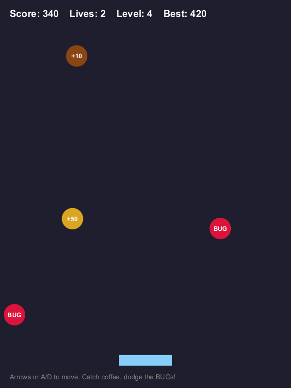
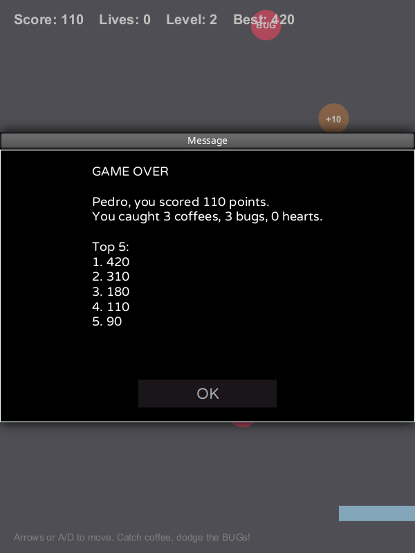

**Integrantes:** Pedro Domitti de Carvalho

---

## 1. O jogo

**Bug Catcher** é um jogo de reflexo com tema de programação. O jogador controla uma cesta na parte de baixo da tela e precisa pegar os cafés que caem, o "combustível" de todo programador, sem pegar os **bugs**.

O objetivo do projeto é **demonstrar os conceitos de Orientação a Objetos estudados na disciplina** de forma simples e legível. Por isso as regras do jogo ficam em classes Java comuns (sem nada do FXGL), e só uma classe conversa com o framework.

{width=48%}

## 2. Mecânicas do jogo

### 2.1 Controles

| Ação | Teclas |
| --- | --- |
| Mover a cesta | **← / →** ou **A / D** |

### 2.2 Itens

A cada 0,7 segundo um item aleatório aparece no topo, em uma posição horizontal aleatória, e cai em linha reta.

| Item | Aparência | Chance | Ao ser pego |
| --- | --- | --- | --- |
| Café (`Coffee`) | círculo marrom `+10` | 50% | +10 pontos |
| Café dourado (`GoldenCoffee`) | círculo dourado `+50` | 10% | +50 pontos; cai 50% mais rápido |
| Bug (`Bug`) | círculo vermelho `BUG` | 37% | −1 vida |
| Coração (`Heart`) | círculo rosa `1UP` | 3% | +1 vida (máximo de 5) |

Itens que não são pegos simplesmente somem ao sair da tela.

### 2.3 Fases, vidas e recordes

- O jogador começa com **3 vidas**.
- A cada **100 pontos** a fase sobe (fase = 1 + pontos / 100) e todos os novos itens caem **30 px/s mais rápido**.
- O HUD mostra pontuação, vidas, fase e o recorde.
- Quando as vidas acabam, aparece a tela de **GAME OVER** com a pontuação, um resumo do que foi pego e o **top 5**. Ao clicar em OK, uma nova partida começa.
- O top 5 é salvo no arquivo `highscores.txt`, então os recordes continuam lá na próxima vez que o jogo abrir.
- O nome do jogador pode ser passado como **argumento de linha de comando** (`./mvnw javafx:run -Dplayer=Ana`).

{width=48%}

## 3. Processo de desenvolvimento

1. **Escolha do jogo.** Procuramos uma mecânica pequena que, mesmo assim, tivesse vários *tipos* de objeto com comportamentos diferentes, para aproveitar herança e polimorfismo. Itens que caem e fazem coisas diferentes ao serem pegos encaixaram bem.
2. **Lista de conceitos.** Pegamos a lista de conteúdos da disciplina e decidimos onde cada um apareceria (veja a seção 7).
3. **Modelagem das classes (UML).** Desenhamos a hierarquia dos itens (`FallingItem` → `Coffee`, `Bug`, `Heart` e `GoldenCoffee`), as interfaces e as classes `Player` e `HighScores` (seção 6).
4. **Estrutura do projeto.** Criamos o projeto Maven com Java 21, FXGL 21.1, JUnit 5 e o *Maven Wrapper*.
5. **Regras em Java puro.** Escrevemos os itens, o jogador e os recordes. Essas classes não dependem do FXGL, por isso foi possível testá-las com **16 testes JUnit** sem abrir janela nenhuma.
6. **Integração com o FXGL.** Escrevemos a `BugCatcherApp`, seguindo o tutorial oficial do FXGL: janela, teclado, criação dos itens com um timer, colisões e HUD.
7. **Testes manuais.** Rodamos o jogo, conferimos o visual por capturas de tela e ajustamos velocidades e probabilidades.
8. **Documentação.** README com instruções, diagrama UML e o mapa de onde cada conceito aparece no código, além deste relatório.

## 4. Desafios e soluções

| Desafio | Solução |
| --- | --- |
| **Ligar nossos objetos às entidades do FXGL.** O FXGL desenha e detecta colisões com objetos próprios (`Entity`), mas as regras estão nas nossas classes. | Cada `Entity` guarda o nosso objeto com `.with("item", item)`. Na colisão, recuperamos o objeto com `entity.getObject("item")` e chamamos `player.caught(item)`. |
| **Velocidade igual em qualquer computador.** Se o item andasse um número fixo de pixels por quadro, ele cairia mais rápido em máquinas com mais FPS. | A velocidade é guardada em pixels **por segundo**. A cada quadro, o item anda `velocidade × tpf` (o tempo do quadro em segundos). |
| **Saber o que fazer com cada tipo de item sem um monte de `if`.** | Polimorfismo: cada subclasse implementa `onCaught(Player)` do seu jeito. A `BugCatcherApp` e o `Player` não precisam saber qual item foi pego. |
| **Arquivo de recordes ausente ou corrompido.** Na primeira execução o arquivo não existe, e alguém pode editá-lo à mão. | `HighScores.load()` usa `try/catch`: arquivo ausente vira uma tabela vazia, e linhas inválidas (texto, números negativos) são ignoradas. Não conseguir salvar também não derruba o jogo. |
| **Manter o top 5 ordenado.** | O novo valor entra num vetor de 6 posições (`System.arraycopy`), que é ordenado com `Arrays.sort`. Depois os 5 maiores voltam para o vetor original. |
| **Recomeçar a partida.** | Ao clicar em OK no *game over*, `startNewGame()` faz o FXGL limpar o mundo e chamar `initGame()` de novo, que cria um `Player` novo. |
| **Simplicidade.** O projeto anterior tinha dezenas de classes e padrões avançados. | Limitamos o projeto a 13 tipos pequenos (classes, interfaces e um enum) e evitamos recursos que não foram vistos na disciplina. |

## 5. Divisão de tarefas por integrante

| Integrante | Responsabilidades |
| --- | --- |
| Pedro Domitti de Carvalho | Escolha do jogo, modelagem das classes e diagrama UML |
| Pedro Domitti de Carvalho | Classes de regras (`items` e `player`) e testes JUnit |
| Pedro Domitti de Carvalho | Integração com o FXGL (`BugCatcherApp`), testes manuais e ajustes |
| Pedro Domitti de Carvalho | README e relatório |

## 6. Diagrama de classes (UML)

O código está organizado em três pacotes:

- `bugcatcher`: `BugCatcherApp` (a única classe que usa o FXGL) e o enum `EntityType`.
- `bugcatcher.items`: as interfaces `Catchable`, `Scorable` e `Dangerous`, a classe abstrata `FallingItem`, as subclasses `Coffee`, `GoldenCoffee`, `Bug` e `Heart`, e a `ItemFactory`.
- `bugcatcher.player`: `Player` e `HighScores`.

## 7. Conceitos de Orientação a Objetos aplicados

| Conceito | Onde aparece |
| --- | --- |
| Classes, objetos, `new`, variáveis de instância | `Player`, `HighScores` e cada item; `new Player(playerName)` em `initGame()` |
| Encapsulamento, *getters* e *setters* | Todos os atributos de `Player` são `private`; `setLives()` valida o valor antes de alterar |
| Modificadores `public`, `protected`, `private` | `FallingItem.speed` é `protected`; o construtor `Coffee(String, double)` é `protected`, para as subclasses |
| Sobrecarga de construtores, `this()`, construtor padrão | `Player()` → `Player(nome)` → `Player(nome, vidas)`; `Coffee(velocidade)` chama `this("Coffee", velocidade)` |
| Referência `this` | `this.lives = lives` em `setLives()` (sombreamento: parâmetro com o mesmo nome do atributo) |
| Sobrecarga de métodos | `ItemFactory.randomItem(nivel)` e `randomItem(nivel, sorteio)` |
| Variáveis e métodos `static` | `FallingItem.createdCount` e `getCreatedCount()`; métodos da `ItemFactory`; `main` |
| Constantes (`final`) | `Player.MAX_LIVES`, `HighScores.SIZE`, `ItemFactory.BASE_SPEED` |
| Classe `Math` | `Math.random()`, `Math.max()`, `Math.min()` |
| Coerção (*casting*) e promoção | `(int) (Math.random() * 100)`; `(level - 1) * SPEED_PER_LEVEL` (o `int` é promovido a `double`) |
| Operador ternário | `newRecord ? "NEW RECORD!" : "GAME OVER"` em `endGame()` |
| Argumentos de linha de comando | `main(String[] args)`: o nome do jogador é `args[0]` |
| Pacotes e API do Java | 3 pacotes próprios; `java.util` (`ArrayList`, `Arrays`) e `java.nio.file` (`Files`, `Path`) |
| Arrays, `length`, tipos por referência | `int[] scores` em `HighScores`; `getScores()` devolve uma cópia, porque o vetor é uma referência |
| Classe `Arrays` e `System.arraycopy` | `sort`, `fill`, `copyOf` e `binarySearch` em `HighScores`; `System.arraycopy` em `add()` |
| `for` aprimorado (*for-each*) | `Player.getSummary()`, `HighScores.save()`/`load()`, `onUpdate()` |
| *Varargs* | Construtor `HighScores(Path file, int... initialScores)` |
| Coleções, `ArrayList`, genéricos | `ArrayList<FallingItem> caughtItems` em `Player` |
| Lançamento de exceções (`throw`), `IllegalArgumentException` | `setLives()`, `addPoints()`, construtor de `FallingItem`, `ItemFactory` |
| Tratamento de exceções (`try/catch`) | `HighScores.load()` (`NoSuchFileException`, `IOException`, `NumberFormatException`) e `save()` |
| `String.format` e `toString()` | `toString()` de `Player`, `FallingItem` e `HighScores`; texto do HUD e da tela de fim de jogo |
| Composição ("tem um") | `BugCatcherApp` tem um `Player` e um `HighScores`; `Player` tem uma lista de itens |
| Herança ("é um"), `extends`, `super()` | `Coffee extends FallingItem`; `GoldenCoffee extends Coffee` chama `super("Golden Coffee", ...)`. Herança simples: cada classe tem uma só superclasse |
| Sobrescrita de métodos e `super.metodo()` | `GoldenCoffee.getPoints()` devolve `super.getPoints() * 5`; `toString()` sobrescreve o de `Object` |
| Classes e métodos abstratos | `FallingItem` é abstrata, com `getColor()`, `getLabel()` e `onCaught()` abstratos |
| Métodos e classes `final` | `createShape()` e `createLabel()` são `final`; `Heart` e `ItemFactory` são classes `final` |
| Polimorfismo e vinculação dinâmica | `player.caught(item)` chama `item.onCaught(this)`, e cada item reage do seu jeito. `Coffee.onCaught()` chama `getPoints()`, que executa a versão de `GoldenCoffee` quando o café é dourado |
| Interfaces, `implements`, múltiplas interfaces | `FallingItem implements Catchable`; `Coffee` é `Catchable` (pela superclasse) e também `Scorable` |
| Constantes em interfaces | `Scorable.BASE_POINTS` (automaticamente `public static final`) |
| Herança de interfaces | `Dangerous extends Catchable` |
| Interfaces × classes abstratas | `Catchable`/`Scorable` só definem *o que* fazer; `FallingItem` também guarda estado (nome, velocidade) e código comum (desenho) |
| Herança de uma classe do framework | `BugCatcherApp extends GameApplication` e sobrescreve os métodos `init...()` e `onUpdate()` |
